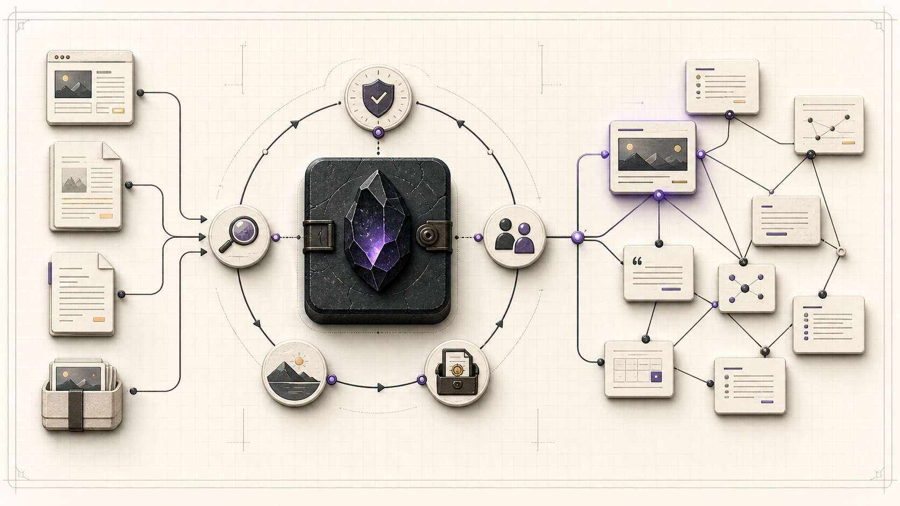
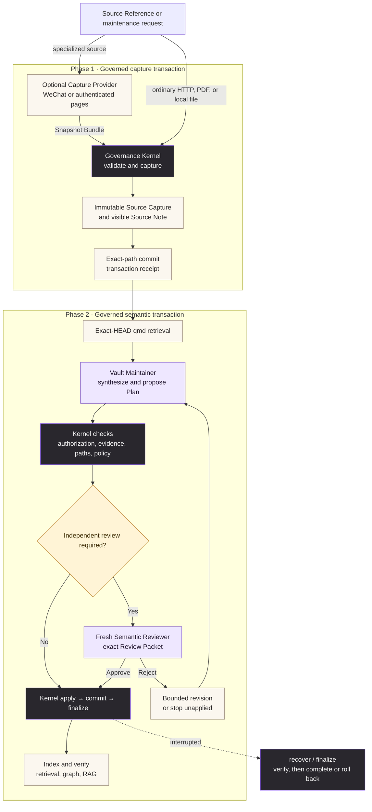
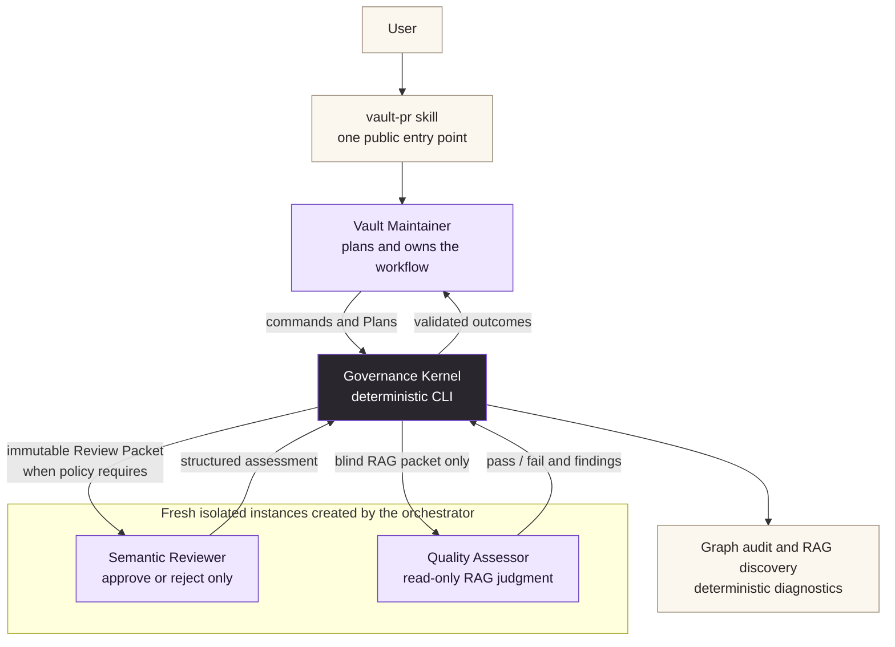

# Obsidian Vault PR

<p align="center">
  
</p>

`obsidian-vault-pr` is a governance and change-management layer for existing
Obsidian vaults. It lets an agent ingest sources, update interlinked notes, run
deterministic checks, request semantic review for risky changes, and leave an
auditable Git transaction.

The project is under active incubation. The first development target is a real
existing vault configured in the Git-ignored `vault-pr.local.toml` file; private
vault content and machine-specific paths must never be committed here.

## Names

- Repository and Python distribution: `obsidian-vault-pr`
- CLI: `vault-pr`
- Agent skill: `vault-pr`

## Current capabilities

The implemented workflow provides:

- `vault-pr doctor` for Git safety and declarative qmd drift checks;
- Capture schema v3 ingestion through pinned HTTP, a Kernel-verified local
  file, or a manifest-driven Snapshot Bundle for WeChat and authenticated
  pages; local absolute paths and provider metadata do not define identity;
- vault-wide lexical or qmd RRF-fused hybrid retrieval for deduplication and
  semantic planning;
- Plan schema v3 with one Write Authorization Snapshot, multiple Evidence
  items, explicit retrieval requirements, governed Source Capture Asset
  promotion, and a 15-note default limit; existing v2 Plans remain readable;
- deterministic Review Packets and structured assessments for split, merge,
  delete, contradiction, `purge_capture`, autonomous repair, or review-all policy;
  the skill orchestration assigns these plans to a separate reviewer agent;
- deterministic plan apply with rollback-on-error, an audit archive, atomic
  expected-HEAD Git commits, and a durable `apply -> commit -> finalize`
  recovery protocol;
- read-only `transaction list`, `show`, and content-free `diff` views over
  active journals and committed receipts;
- qmd collection reconciliation, capability-gated update, exact-HEAD freshness,
  and incremental embedding with at most three retries after the first attempt;
- disposable live capture-route canaries for HTML, PDF, provider-assisted
  WeChat, and environment-gated authenticated snapshots;
- read-only Note Role graph audits and vault-owned RAG evaluation cases with
  deterministic retrieval metrics and hash-bound blind-RAG assessor packets;
- formal Vault Maintainer, Quality Assessor, and Semantic Reviewer contracts
  behind one user-facing skill.

The governance kernel is the stable core. Capture-route canaries, Capture
migration, graph/RAG quality workflows, Quality Records, and autonomous repair
are experimental surfaces: they remain governed and tested, but do not yet carry
a production-compatibility promise.

## Support boundary

- Python 3.11 through 3.13 on POSIX systems (currently Linux and macOS); Windows
  is unsupported because the transaction lock and file-safety implementation
  use POSIX APIs.
- Git is required. qmd and Defuddle are external executables whose capabilities
  are probed by `vault-pr doctor`; compatibility is capability-based rather than
  a blanket version promise.
- Hybrid index freshness binds the qmd version, retrieval mode, embedding-model
  identity, and chunk strategy without exposing the local model path. The model
  identity hashes resolved local bytes or an exactly identified single-file qmd
  GGUF cache entry when present; otherwise it conservatively binds the exact
  locator. Changes to a supported artifact invalidate freshness once qmd
  materializes it.
- The deterministic validator implements a documented Obsidian syntax subset,
  not every parser behavior of the Obsidian application. See
  [Supported Obsidian syntax](docs/supported-obsidian-syntax.md).
- The Python wheel contains the Governance Kernel only. Register or symlink
  [`skills/vault-pr`](skills/vault-pr) with the chosen agent harness separately;
  its OpenAI adapter disables implicit invocation, but routing policy is not a
  security boundary. Clean-state, review, transaction, and exact-commit gates
  remain authoritative.

## Architecture at a glance

The workflow has two durable boundaries. Capture first records the source in an
immutable, content-bound archive and commits that capture transaction. Semantic
integration then becomes a separate, reviewable transaction over the existing
vault.



### Agent role relationships

Only the three purple boxes below are agent roles. Capture Providers and the
Governance Kernel are capabilities. The orchestrator creates every reviewer and
assessor as a fresh isolated instance: reviewers cannot edit or replan, and
assessors cannot approve transactions or plan repairs.



## Capability boundary

The CLI is a deterministic Governance Kernel, not a registry of agent skills.
It directly handles ordinary public HTTP sources and accepts untrusted local
Snapshot Bundles for specialized sources. The agent skill may compose optional
Capture Providers such as `wechat-article-to-markdown`, but the Python package
does not depend on those skills or their packages. See
[the Capture Provider decision](docs/adr/0001-compose-specialized-capture-providers.md)
and [the provider contract](skills/vault-pr/references/capture-providers.md).

`defuddle` and `qmd` are external executables checked by `vault-pr doctor`;
`pypdf` and PyYAML are Python package dependencies. The `defuddle` agent skill is
not a CLI dependency.

## Positioning among agent-managed Obsidian projects

Most mature open-source work in this space follows
[Karpathy's LLM Wiki pattern](https://gist.github.com/karpathy/442a6bf555914893e9891c11519de94f):
immutable `raw/` sources, an agent that compiles and maintains an interlinked
Markdown wiki, then index/lint/query loops. Several of those projects can
already replace `obsidian-vault-pr` for greenfield wiki maintenance. The
remaining question is which layer owns durable change safety on an **existing**
vault.

Comparison below is qualitative (architecture and intended job), not a shared
benchmark. Stars and activity noted as of 2026-07-17.

| Project                                                                                   | Primary role                                                              | What it does well                                                                                          | Honest take vs `vault-pr`                                                                                                                                                                       |
| ----------------------------------------------------------------------------------------- | ------------------------------------------------------------------------- | ---------------------------------------------------------------------------------------------------------- | ----------------------------------------------------------------------------------------------------------------------------------------------------------------------------------------------- |
| [obsidian-wiki](https://github.com/Ar9av/obsidian-wiki) (~2.9k★)                          | Balanced Karpathy wiki framework for many coding agents                   | Ingest, lint, rebuild, multi-agent adapters, vault lifecycle without locking you to one harness            | Strong substitute for building a new wiki vault. Weaker as a deterministic write kernel for a vault that already has its own folders and note roles.                                            |
| [obsidian-second-brain](https://github.com/eugeniughelbur/obsidian-second-brain) (~3.3k★) | Highest-automation AI-first second brain                                  | ~44 commands, scheduled maintenance, hybrid search, web research, self-rewriting notes                     | Can replace the _maintenance effect_ of `vault-pr` if you adopt its conventions. Broad surface area; safety leans on agent workflow rather than a content-bound transaction + recover protocol. |
| [claude-obsidian](https://github.com/AgriciDaniel/claude-obsidian) (~9.5k★)               | Most popular Claude Code wiki skill + methodology pack                    | Source ingest, concept pages, contradiction callouts, LYT/PARA/Zettelkasten modes, per-file advisory locks | Excellent greenfield substitute under Claude Code. Advisory locks and Obsidian Git auto-commits are not the same as journaled exact-path apply/commit/finalize.                                 |
| [llm-wiki-agent](https://github.com/SamurAIGPT/llm-wiki-agent) (~3.2k★)                   | Lightweight cross-agent self-maintaining wiki skill                       | Low runtime footprint; works with Claude Code, Codex, OpenCode, Gemini CLI                                 | Can replace `vault-pr` for a new Karpathy wiki when you want skills without a governance CLI. Little independent review or recovery machinery.                                                  |
| [obsidian-mind](https://github.com/breferrari/obsidian-mind) (~3.4k★)                     | Persistent work memory for coding agents                                  | Session lifecycle hooks, qmd retrieval, structured project/decision/person memory                          | Different job: engineering memory across sessions, not general source-to-wiki maintenance of an arbitrary existing vault.                                                                       |
| [llm-wiki-compiler](https://github.com/atomicstrata/llm-wiki-compiler) (~1.8k★)           | Research-oriented knowledge compiler                                      | Claim/paragraph provenance, line-level citations, two-stage generation, hybrid retrieval                   | Strong substitute when the goal is a research wiki with strict citations. Obsidian is mainly a viewer; not a vault-agnostic governance layer.                                                   |
| [Synto](https://github.com/kytmanov/synto) (~0.2k★)                                       | Local Ollama-first wiki compiler (successor to `obsidian-llm-wiki-local`) | Stable entity IDs, rename/merge/split, draft approval, compile lineage, offline eval                       | Closest _product instincts_ among compilers (drafts, lineage, eval). Younger project; still a wiki compiler, not an adopt-existing-vault write kernel.                                          |

Related layers that are useful with, rather than instead of, the projects above:
[Claudian](https://github.com/YishenTu/claudian) / [obsidian-agent-client](https://github.com/RAIT-09/obsidian-agent-client)
(agent UI inside Obsidian), [obsidian-skills](https://github.com/kepano/obsidian-skills)
(Obsidian format/CLI fluency), and [qmd](https://github.com/tobi/qmd) (local
BM25/vector search).

### What is unique here

`obsidian-wiki` and peers answer “how should an agent grow a knowledge wiki?”
`obsidian-vault-pr` answers a narrower question: **on a vault you already trust,
when is an agent write finished, justified, and recoverable?**

That is the foothold:

- **Adopt, do not redesign.** Keep the vault’s folders, note roles, and
  methodology. Do not require PARA, Zettelkasten, or a greenfield wiki layout.
- **Evidence ≠ authority.** A captured source can justify a change; only a
  bounded Write Authorization Snapshot lets the agent propose it.
- **Independent review for risk.** Merge, delete, contradiction handling, and
  similar operations bind a separate Semantic Reviewer to a deterministic Review
  Packet for the exact Plan and files.
- **Deterministic write kernel.** Clean-worktree gate, 15-note default limit,
  exact-path apply/commit, transaction receipts, and verified
  `apply → commit → finalize` recovery — not agent-convention Git alone.
- **Post-write system checks.** Exact-HEAD qmd freshness, Note Role graph
  audits, and accepted RAG evaluation baselines after content is committed.

If you are starting a new digital brain and are happy for the agent to own
organization, a wiki project is often enough. Use `vault-pr` when the vault is
already old, shared, or sensitive, and you need each durable change to be
authorized, evidenced, reviewed when necessary, committed exactly, and
recoverable.

### How to combine with related tools

**Default: pick one primary write path.** A full wiki skill pack such as
[obsidian-wiki](https://github.com/Ar9av/obsidian-wiki) and the `vault-pr`
skill both teach the agent to change vault files and often to commit. Running
both as first-class writers usually conflicts (direct edits vs journaled apply,
`wiki-sync` / bare Git vs `vault-pr commit`, competing folder conventions).

- Starting a greenfield digital brain and happy for the agent to own
  organization → use a wiki project alone.
- Maintaining an existing Git-managed vault with auditable transactions → use
  `vault-pr` alone; put note-shape rules in your own `AGENTS.md` / schema if
  needed.

**Safe to combine with `vault-pr`:** format skills
([obsidian-skills](https://github.com/kepano/obsidian-skills)), local retrieval
([qmd](https://github.com/tobi/qmd)), and an optional agent UI
([Claudian](https://github.com/YishenTu/claudian) /
[obsidian-agent-client](https://github.com/RAIT-09/obsidian-agent-client)).
Those do not replace the write kernel.

```text
Obsidian vault (Git)
├── Your AGENTS.md / note schema   # how notes should look
├── Obsidian format skills         # wikilinks, Bases, CLI fluency
├── Agent UI (optional)
├── qmd                            # BM25 / vectors
└── vault-pr                       # only path that mutates + commits
```

**Optional advanced stack** (wiki methodology + `vault-pr`) only if you enforce:

1. Wiki skills may advise synthesis and linking; they must not write vault files
   or run Git.
2. Every durable mutation goes through `vault-pr` capture → plan → review →
   apply → commit → recover.
3. Disable wiki auto-sync / stage-all helpers; never bare `git add` / `git commit`
   for agent-maintained changes while a transaction is active.
4. Keep product commits in this repository and knowledge commits in the vault;
   serialize Git writes on the same vault.

If you cannot hold that boundary, treat wiki packs and `vault-pr` as mutually
exclusive.

## Local setup

```bash
cp vault-pr.example.toml vault-pr.local.toml
# Edit vault.path in the local file.
uv sync
uv run vault-pr doctor --config vault-pr.local.toml
uv run vault-pr ingest https://example.com/article \
  --config vault-pr.local.toml --apply
uv run vault-pr ingest ./reference.pdf --adapter local_file \
  --logical-name "Reference PDF" --config vault-pr.local.toml --apply
# Commit only the returned transaction's paths and close its journal under lock.
uv run vault-pr commit txn_ingest_... --message "Ingest source article" \
  --config vault-pr.local.toml
uv run vault-pr transaction list --config vault-pr.local.toml
uv run vault-pr transaction show txn_ingest_... \
  --config vault-pr.local.toml
uv run vault-pr transaction diff txn_ingest_... \
  --config vault-pr.local.toml
uv run vault-pr migrate captures-v3 \
  --config vault-pr.local.toml
uv run vault-pr index --config vault-pr.local.toml
uv run vault-pr retrieve src_0123456789abcdef0123 \
  --config vault-pr.local.toml
uv run vault-pr plan init --source-id src_0123456789abcdef0123 \
  --summary "Integrate the source" \
  --authorization-summary "Integrate the captured source" \
  --config vault-pr.local.toml
uv run vault-pr canary https://www.rfc-editor.org/rfc/rfc9110.html \
  --adapter http
uv run vault-pr quality graph --config vault-pr.local.toml
uv run vault-pr quality rag --answers /tmp/vault-pr-rag-answers.jsonl \
  --config vault-pr.local.toml > /tmp/vault-pr-rag-evaluation.json
uv run vault-pr quality rag-accept \
  --evaluation /tmp/vault-pr-rag-evaluation.json \
  --assessment /tmp/vault-pr-rag-assessment.json --apply \
  --config vault-pr.local.toml
```

The local configuration is intentionally ignored by Git.

Use `vault-pr migrate captures-v3` to inspect schema-v2 Capture upgrades without
writing. A new `--apply` starts only on a clean Vault; an exact retry may instead
return the existing transaction and its required `commit` or `recover` action.
Runtime consumers reject Capture v1/v2; the explicit migration validates the
old tree, derives the new content-bound identity, rewrites exact source-ID
tokens, and leaves a recoverable transaction finalized with `vault-pr commit`.

`vault-pr canary` uses a disposable Git and qmd fixture and never writes the
configured user vault. It validates capture, exact-path commit, indexing, and
retrieval, then removes the fixture collection; semantic integration remains a
separate agent judgment. User-supplied retention URLs always go through the real
configured vault workflow instead of this disposable command.

`vault-pr quality graph` reports durable-link findings by Note Role without
writing. `vault-pr quality rag` reads human-accepted cases from
`.vault-pr/quality/rag/cases.jsonl`, scores expected retrieval, and binds a
temporary JSONL answer file plus bounded note excerpts into the packet a fresh
Quality Assessor uses to judge claims and provenance. Omitting `--answers`
creates discovery-only diagnostic evidence. A passed assessor output must be
recorded with `quality rag-accept` and finalized with `vault-pr commit`; only
that Git-tracked Quality Record is a baseline. Runs on a dirty worktree remain
diagnostic and return `assessment_candidate_eligible: false`.

Use `vault-pr index --check` for a read-only collection drift report. A normal
`vault-pr index` repairs only explicitly configured collections, leaves all
unmanaged collections untouched, and then refreshes lexical and vector indexes.
Every journaled mutation uses the same executor and writes a Git-tracked
transaction receipt. A new apply returns its domain status with
`requires_commit: true`. If an exact schema-v3 Capture and Source Note are
already committed but their receipt is absent, ingest returns `adopted` and
creates a receipt-only transaction without rewriting those artifacts. Retrying
the exact request returns `already_active` with `next_action: commit` or
`recover`; after finalization it returns `already_committed`. Reusing a
transaction ID with a different request digest is an integrity error. Run
`vault-pr commit <transaction-id> --message <message>
--config vault-pr.local.toml`; it holds the vault lock, stages only journal paths,
constructs the commit through a temporary index, atomically advances the
expected branch HEAD, and finalizes. Finalization verifies the clean worktree,
new commit, complete commit-path range, every committed file hash, and Git mode,
plus the transaction receipt before removing the journal. Recovery
journals bind to a one-way `vault_id`; they do not persist or print the absolute
Vault path. Retrieval and Plan
validation re-verify Capture identity, exact declared files, hashes, MIME
signatures, and the independently resolved unique Source Note before consuming
it. Retrieval also requires freshness for the exact Vault HEAD, relevant index
configuration, and qmd runtime identity. Indexing refuses to run before
commit finalization. `vault-pr finalize` remains available when a commit was
completed before a process interruption.
If a process stops before finalization, run
`vault-pr recover --config vault-pr.local.toml`. Recovery auto-finalizes an
already committed exact result, or rolls back an uncommitted result only after
journal, backup, file-state, and Git-state verification succeeds.

Use `vault-pr transaction list|show|diff` for the implemented lifecycle view:
`APPLIED` permits commit or recovery, `COMMITTED` permits finalize or recovery,
`RECOVERY_REQUIRED` permits recovery, and `FINALIZED` has no write action. The
views expose paths, hashes, modes, and blocking reasons, never note content. See
[Transaction state machine](docs/transaction-state-machine.md) and
[CLI protocol](docs/cli-protocol.md).

Reviewer independence is an orchestration guarantee, not a local identity or
cryptographic boundary. The CLI regenerates a deterministic Review Packet,
requires a closed structured assessment, and binds it to the exact Plan and
proposed files; the orchestrator must ensure the planner does not review its own
risky transaction.
